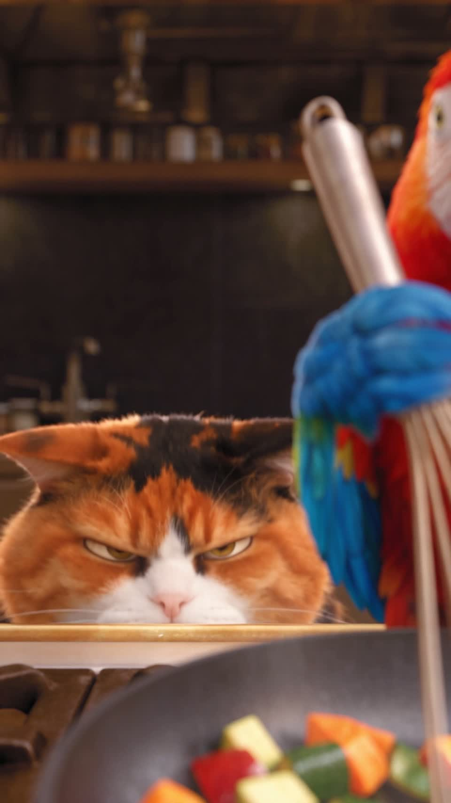

# 迪士尼风格动画导演 · Animation Director

将「场景图 + 角色图 + 一两句话的情节」转化为动作清晰、富有弹性、镜头节奏鲜明的动画视频提示词。

结合经典动画十二原则与电影分镜，先设计角色怎么演，再设计观众怎么看。适用于角色表演、动作喜剧、参考图动画化和已有视频提示词的修改。

## 安装

把下面这句话复制给支持 Skill 安装的 Agent：

```text
请帮我安装这个迪士尼风格动画导演 Skill：https://github.com/AgentLiiiiii/animation-director
```

本仓库根目录即为技能目录，入口是 [SKILL.md](SKILL.md)。安装时请同时保留 `references/`、`scripts/` 和 `agents/`。

## 使用

安装后，向 Agent 提供：

1. 场景图；
2. 角色图（可以与场景在同一张图中）；
3. 一两句话的情节描述。

时长、画幅、对白、目标模型可按需要补充。每次设计一个 **4–30 秒**的提示词单元，输出「画面内容、时间线、全局约束」三项。

例如：

```text
请使用 animation-director。我提供了场景图和角色图：
鹦鹉在灶台前炒菜，肥猫从它身后的桌面下缓缓探头，举爪偷袭，鹦鹉惊险躲过。
请设计一段 15 秒的动画视频提示词，突出两者的动态反差、喜剧停顿和镜头冲击，无背景音乐。
```

## 演示短片

点击小封面可单独观看；也可以展开下方播放器在本页播放。

<table>
<tr>
<th>肥猫与蝴蝶 · 15 秒</th>
<th>鹦鹉与肥猫 · 14 秒</th>
</tr>
<tr>
<td align="center"><a href="https://github.com/user-attachments/assets/bebda8ef-c458-433f-b5fe-a4be94ce7e21"></a></td>
<td align="center"><a href="https://github.com/user-attachments/assets/4f4012a0-bdc6-4b9d-87dc-2a7f2faf1a95"></a></td>
</tr>
<tr>
<td align="center"><a href="https://github.com/user-attachments/assets/bebda8ef-c458-433f-b5fe-a4be94ce7e21">▶ 观看肥猫与蝴蝶</a></td>
<td align="center"><a href="https://github.com/user-attachments/assets/4f4012a0-bdc6-4b9d-87dc-2a7f2faf1a95">▶ 观看鹦鹉与肥猫</a></td>
</tr>
</table>

<details>
<summary>▶ 展开播放：肥猫与蝴蝶（横版）</summary>

https://github.com/user-attachments/assets/bebda8ef-c458-433f-b5fe-a4be94ce7e21

</details>

<details>
<summary>▶ 展开播放：鹦鹉与肥猫（竖版）</summary>

https://github.com/user-attachments/assets/4f4012a0-bdc6-4b9d-87dc-2a7f2faf1a95

</details>

## 能力与边界

- 动画表演：意图、预备动作、关键姿势、重量、弹性、惯性跟随与回弹。
- 摄影分镜：景别变化、运镜起止、剪辑节拍、注意目标与动作连续性。
- 提示词检查：附带 Python 3 结构与时间码校验脚本；脚本只检查结构和时间，不评价动画质量。
- 本 Skill 交付文字导演方案与提示词；视频生成需使用相应视频模型，效果取决于素材、模型及执行情况。

“迪士尼风格”指动画表演方法与美学参考；本项目并非迪士尼官方产品，与迪士尼或皮克斯无隶属、授权或背书关系。

## 使用许可

允许安装、使用以及为自身使用进行修改；允许将使用本 Skill 创作的作品用于商业项目。

**未经作者书面授权，禁止将本 Skill 及其修改版单独转售、打包收费分发、作为付费会员资源提供，或改名后转售。**

完整条款见 [LICENSE.md](LICENSE.md)。本项目采用自定义使用许可。

## 文件结构

- `SKILL.md`：主指令
- `references/`：动画表演、角色动势、摄影及交付参考
- `scripts/`：提示词结构校验与测试
- `agents/openai.yaml`：Agent 展示配置
- `demos/`：演示短片
